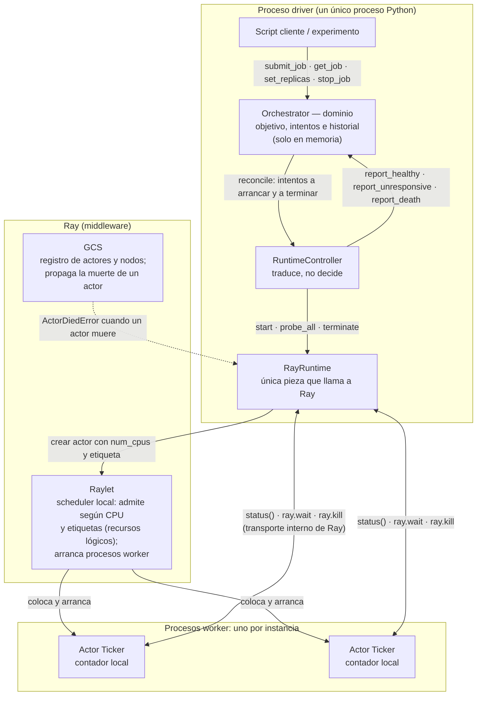

# Arquitectura: aplicación y entorno de ejecución

Prototipo de la fase Ray. Muestra los componentes de nuestra aplicación, los componentes de Ray de los que dependen y dónde vive cada estado.

## Vista general

Todo corre en una sola computadora (WSL2): un nodo Ray con varios procesos. Las flechas dentro del driver son llamadas Python; las que cruzan a Ray o a los workers son mensajes entre procesos que Ray transporta por nosotros.

## Quién es dueño de qué

| Estado o decisión | Dueño | Dónde vive | Si falla su dueño |
|---|---|---|---|
| Objetivo de réplicas | Dominio (`Orchestrator`) | Memoria del driver | Se pierde: no hay persistencia en esta fase |
| Intentos y sus estados | Dominio | Memoria del driver | Se pierde con el driver |
| Historial de eventos | Dominio | Memoria del driver (se puede volcar a JSONL) | Se pierde salvo lo ya volcado |
| Progreso de una instancia | El actor | Memoria de su proceso worker | Se pierde; el reemplazo empieza de cero |
| Admisión y colocación | Ray (raylet) | Ray | — |
| Detección de que un proceso murió | Ray (GCS) | Ray | — |
| Decidir reemplazar, abandonar o detener | Dominio (`reconcile`) | Memoria del driver | — |

## El ciclo de control

Cada ciclo hace dos cosas, siempre en este orden:

1. **Observar:** el controlador consulta a todos los intentos activos **a la vez**, con un solo plazo (`probe_all`), y traduce cada respuesta en un informe al dominio.
2. **Actuar:** el dominio compara objetivo e intentos (`reconcile`), **registra sus decisiones antes de actuar** y devuelve qué intentos arrancar y cuáles terminar; el controlador se lo pide al runtime.

Una fase normal converge en dos ciclos: en el primero se decide y se pide, en el segundo se observa el resultado ([F0](F0.md)).

## Reglas que el diseño garantiza

- El script cliente solo invoca operaciones del dominio. Nunca toca Ray directamente.
- El dominio separa el **objetivo deseado** de los **intentos observados**. Una caída nunca cambia el objetivo.
- El controlador es un traductor: transforma observaciones en informes y decisiones en peticiones. No decide ninguna transición de estado.
- El runtime es lo único que habla con Ray: crea actores, los consulta, pide su terminación y devuelve observaciones.
- Cada instancia es un actor en su propio proceso. Su estado local se pierde si el proceso termina, y el reemplazo **no** lo restituye ([F1](F1.md)).
- **Pedir la terminación no es confirmarla.** Una parada intencional queda en `STOPPING` hasta que una consulta recibe la confirmación de Ray; solo entonces pasa a `STOPPED`.
- **Un silencio no es una muerte.** Una consulta sin respuesta deja el intento en `UNKNOWN`. Un intento pasa a `FAILED` de una de dos formas:
  - **por observación:** Ray confirma que el proceso murió (`ActorDiedError`), como en [F1](F1.md);
  - **por decisión:** el controlador lo abandona tras K consultas perdidas, pide terminar su proceso y solo entonces lo reemplaza, como en [F3](F3.md).

## Dónde está cada pieza

| Componente | Archivo |
|---|---|
| Dominio | [`orchestrator/model.py`](../orchestrator/model.py), [`orchestrator/api.py`](../orchestrator/api.py) |
| Controlador | [`orchestrator/controller.py`](../orchestrator/controller.py) |
| Tipos compartidos con el runtime | [`orchestrator/runtime.py`](../orchestrator/runtime.py) |
| Runtime de Ray y actor `Ticker` | [`ray_runtime.py`](../ray_runtime.py) |
| Líneas de tiempo de fallos | [`orchestrator/evidence.py`](../orchestrator/evidence.py) |
