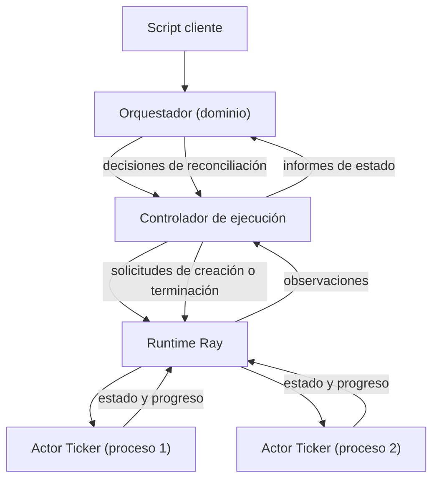

# Diagrama de aplicación y entorno de ejecución

## Vista general

## Explicación

- El script cliente invoca únicamente operaciones del dominio. No interactúa directamente con Ray.
- El dominio mantiene el objetivo deseado y el registro de intentos por separado del estado observado. Dicho estado reside únicamente en memoria durante la sesión.
- El controlador de ejecución actúa como traductor: transforma las observaciones obtenidas del runtime en informes hacia el dominio y traduce las decisiones del dominio en solicitudes al runtime.
- El runtime es el único componente que interactúa con Ray. Es responsable de crear actores, sondear su estado, solicitar su terminación y devolver observaciones acotadas.
- Cada instancia corresponde a un actor independiente en un proceso distinto. El estado local de cada actor se pierde si el proceso finaliza. La recuperación no lo restituye.
- La solicitud de terminación y la confirmación de la muerte son momentos distintos. Una parada intencional transita por el estado correspondiente hasta que la muerte es confirmada.
- La ausencia de respuesta dentro de un plazo constituye incertidumbre, no una muerte. Solo una excepción que confirma la finalización del proceso justifica marcarlo como finalizado por fallo o como detenido según el caso.
